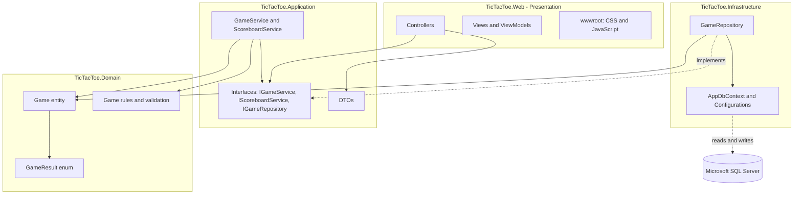
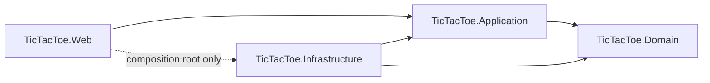
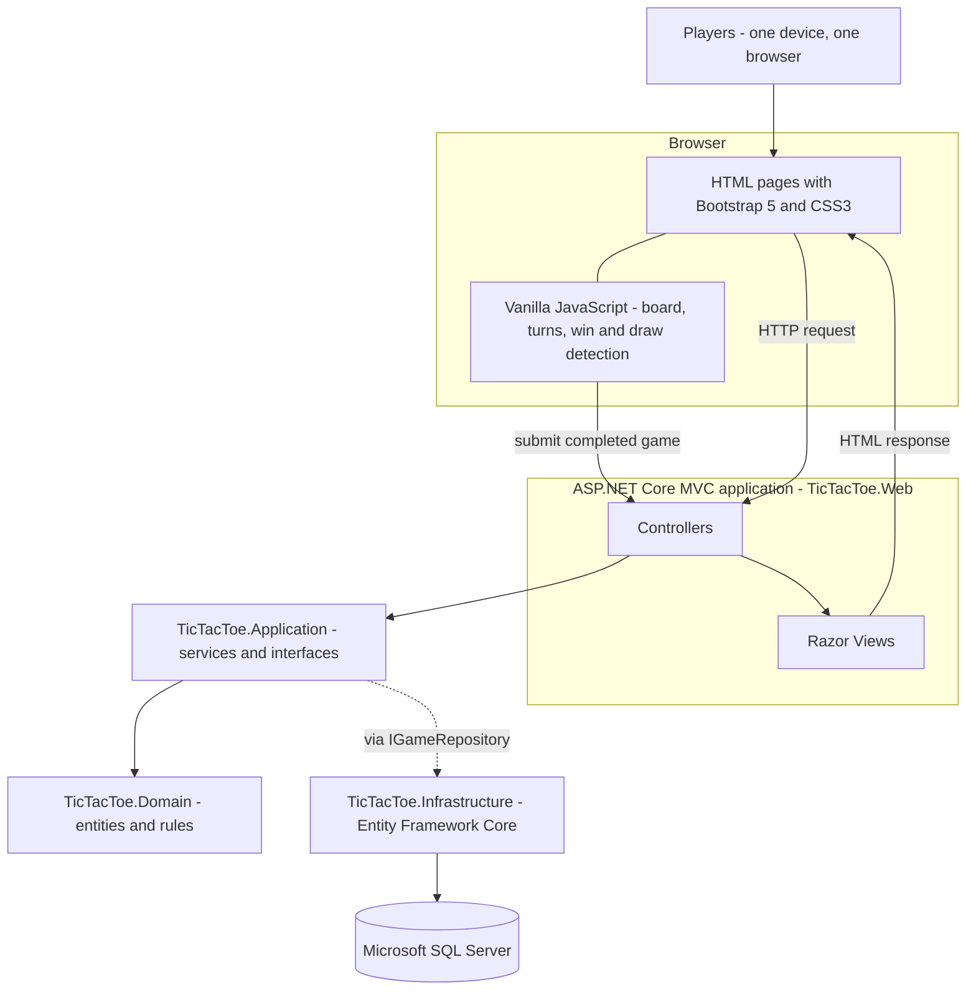
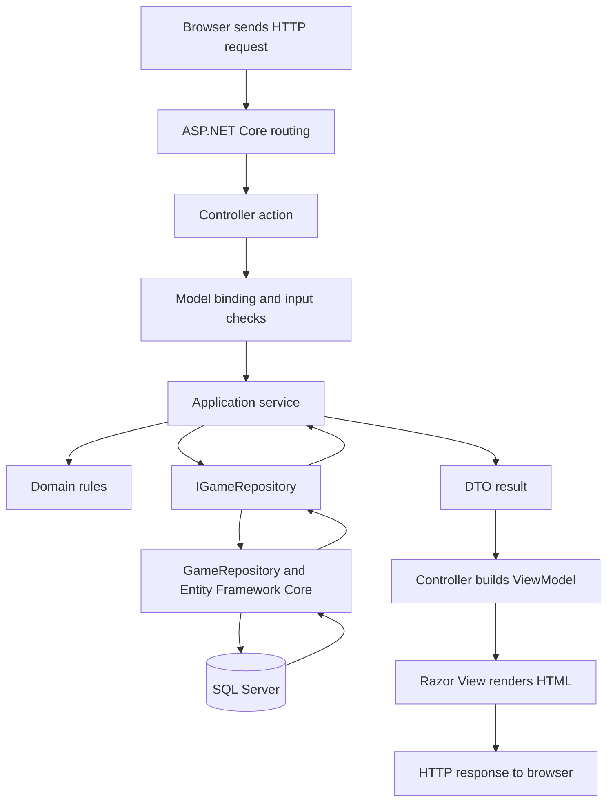
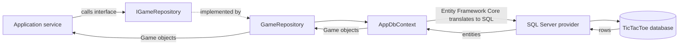
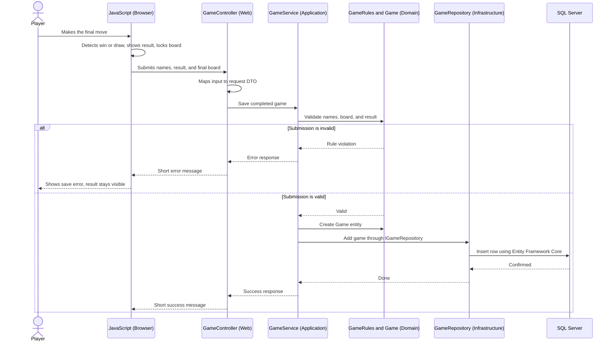
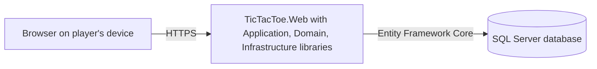

# Software Architecture Document
## Tic-Tac-Toe Web Application

---

## 1. Document Information

| Field | Details |
|---|---|
| **Document Title** | Software Architecture Document |
| **Project Name** | Tic-Tac-Toe Web Application |
| **Project Type** | Full-Stack Web Application (Course Assignment) |
| **Version** | 1.0 |
| **Date** | November 4, 2026 |
| **Document Status** | Draft – Submitted for Instructor Review |
| **File Location** | `docs/Architecture.md` |
| **Primary Sources** | `PRD.md` (v1.0), `TechStack.md` (v1.0) |
| **Related Documents** | SRS, Use Case Diagram, Database Design, UI/UX Design |

> **Important:** Section 20 and Appendix A list inconsistencies found between this document, `PRD.md`, and `TechStack.md`. They were identified rather than silently resolved, and each one has a proposed resolution.

---

## 2. Introduction

### 2.1 Purpose

This document describes the software architecture of the Tic-Tac-Toe Web Application. It explains how the application is divided into four projects, what each project is responsible for, how the projects depend on each other, and how a request travels through them.

### 2.2 Audience

| Audience | Use of This Document |
|---|---|
| Course instructor | Reviews the architectural decisions and their justification |
| Developer(s) | Uses it as the blueprint for creating the solution and its projects |
| Future maintainers | Understands where each kind of code belongs |

### 2.3 Scope

This document covers structure, responsibilities, dependencies, workflows, and deployment. It does not contain source code, database column definitions, or screen designs. Those belong to the SRS, Database Design, and UI/UX Design documents.

---

## 3. Project Overview

| Item | Description |
|---|---|
| **Project Name** | Tic-Tac-Toe Web Application |
| **Description** | A web-based Tic-Tac-Toe game where two players play against each other on the same device |
| **Core Features** | Home page, player name input, interactive 3×3 board, automatic winner and draw detection, result display, restart, scoreboard, and game history |
| **Users** | Two players sharing one device and one browser; no login |
| **Stored Data** | Completed games: players' names, result, winner, and date/time (PRD FR-025) |

### 3.1 Technology Summary (from TechStack.md)

| Layer | Technology |
|---|---|
| Frontend | HTML5, CSS3, Bootstrap 5, Vanilla JavaScript |
| Backend | ASP.NET Core MVC, C# |
| Database | Microsoft SQL Server |
| ORM | Entity Framework Core |
| Tools | Visual Studio 2022, SQL Server Management Studio, Git, GitHub (Visual Studio Code is optional for editing front-end files and documents) |

---

## 4. Architecture Goals and Principles

### 4.1 Goals

| ID | Goal | How the Architecture Supports It |
|---|---|---|
| AG-001 | Keep business rules independent of technology | Rules live in the Domain project, which has no external dependencies |
| AG-002 | Keep the project understandable for beginners | Only four projects, one entity, and a small number of classes |
| AG-003 | Make the database replaceable and the logic testable | Application code depends on interfaces, not on Entity Framework Core |
| AG-004 | Keep the application a single deployable unit | One MVC web application plus one database; no separate frontend |
| AG-005 | Stay consistent with the PRD scope | No features beyond the ten core features |

### 4.2 Principles

| Principle | Meaning in This Project |
|---|---|
| **Separation of concerns** | Each project has one clear responsibility |
| **Dependency rule** | Source-code dependencies point inward, toward the Domain |
| **Dependency inversion** | Inner layers define interfaces; outer layers implement them |
| **Simplicity first** | A pattern is used only when it solves a real problem in this project |
| **Server-side validation** | The server re-checks every submitted result, even though the browser also checks |
| **Single source of truth** | Business rules are defined once in the Domain; the browser copy is for user experience only |

---

## 5. Architectural Style

The application uses a **Simplified Clean Architecture** implemented as four .NET projects, with **ASP.NET Core MVC** as the presentation technology.

| Decision ID | Decision | Rationale |
|---|---|---|
| AD-001 | Use Simplified Clean Architecture with four projects | Gives clear separation without excessive layers |
| AD-002 | Use ASP.NET Core MVC | Matches `TechStack.md`; Views render pages and Controllers handle requests |
| AD-003 | No separate frontend application | The browser code (CSS, JavaScript) is part of the Web project |
| AD-004 | One repository interface for the single entity (no generic repository, no Unit of Work) | See Section 14.4 |
| AD-005 | No CQRS, MediatR, microservices, event sourcing, or authentication | Not required by the PRD; would add unnecessary complexity |
| AD-006 | The browser sends the final board state together with the result so the server can verify it. The board is used only for validation and is not stored | Allows true server-side validation of wins and draws (see Section 13.3 and Appendix A, item C-03) |

### 5.1 Patterns Used

| Pattern | Where Used | Justification |
|---|---|---|
| Model-View-Controller (MVC) | Web project | Required by the technology stack |
| Dependency Injection | Whole solution | Built into ASP.NET Core; connects interfaces to implementations |
| Repository (single, specific) | `IGameRepository` | Needed to keep Entity Framework Core out of the Application project |
| Data Transfer Object (DTO) | Application project | Carries data across layer boundaries without exposing entities |

---

## 6. Technology Architecture

| Technology | Project Where It Is Used | Role |
|---|---|---|
| C# / .NET | All four projects | Programming language and platform |
| ASP.NET Core MVC | `TicTacToe.Web` | Routing, Controllers, Views, model binding |
| Razor Views | `TicTacToe.Web` | Server-side HTML page generation |
| HTML5, CSS3, Bootstrap 5 | `TicTacToe.Web` (Views, `wwwroot`) | Page structure, styling, responsive layout |
| Vanilla JavaScript | `TicTacToe.Web` (`wwwroot/js`) | Board interaction, turn handling, win/draw detection in the browser |
| Entity Framework Core | `TicTacToe.Infrastructure` only | Object-relational mapping and migrations |
| Microsoft SQL Server | External to the solution | Permanent storage |

**Key rule:** Entity Framework Core and SQL Server details are visible only inside `TicTacToe.Infrastructure`. No other project references them.

---

## 7. Clean Architecture Overview

### 7.1 Concept

Clean Architecture arranges code in concentric layers. The innermost layer contains the business rules. Each outer layer wraps the inner ones and may know about them, but inner layers know nothing about outer layers. This keeps the important rules (what a valid game is) free from technical details (web pages, databases).

### 7.2 Diagram A – Overall Clean Architecture



*Arrows between projects show source-code dependencies. The dotted arrow to SQL Server shows runtime communication, not a code dependency.*

### 7.3 Why Dependencies Point Inward

| Reason | Explanation |
|---|---|
| **Stability** | The Domain changes least (Tic-Tac-Toe rules rarely change). Outer layers, such as the database or the user interface, change more often. Depending on the stable part protects the application from frequent change. |
| **Protection of business rules** | If the Domain depended on the database, a database change could force changes to game rules. |
| **Replaceability** | The database technology or the UI can be changed without rewriting the Domain or the Application. |
| **Testability** | Inner layers can be tested without a database or a web server. |
| **Clarity** | Developers always know where a type of code belongs and which direction references may go. |

### 7.4 Dependency Inversion

**Dependency inversion** means that high-level code (the Application services that decide *what* should happen) does not depend on low-level code (the database code that decides *how* it is stored). Instead, both depend on an abstraction.

| Step | Description |
|---|---|
| 1 | The Application project defines an interface, `IGameRepository`, describing what it needs: add a game, get all games, get win counts. |
| 2 | Application services call only this interface. They never see Entity Framework Core. |
| 3 | The Infrastructure project provides a class, `GameRepository`, that implements the interface using Entity Framework Core. |
| 4 | At startup, dependency injection connects the interface to the implementation. |

Without inversion, the Application would reference Infrastructure. With inversion, **Infrastructure references Application** (it implements Application's interface). The dependency arrow therefore points inward even though, at runtime, the Application calls the database code.

---

## 8. Layer Responsibilities

### 8.1 Summary

| Project | Layer | Primary Responsibility |
|---|---|---|
| `TicTacToe.Domain` | Core | Business entities, enums, rules, and domain validation |
| `TicTacToe.Application` | Application logic | Use cases, services, interfaces, and DTOs |
| `TicTacToe.Infrastructure` | Data and external concerns | Entity Framework Core, database context, configurations, migrations, repository implementation |
| `TicTacToe.Web` | Presentation | MVC Controllers, Views, ViewModels, browser code, dependency injection configuration |

### 8.2 TicTacToe.Domain

| Aspect | Description |
|---|---|
| **Contains** | `Game` entity, `GameResult` enum, game rules (winning lines, draw condition, name rules), a domain validation exception |
| **Responsibilities** | Define what a valid completed game is; enforce rules such as valid names and a result that matches the winner; decide whether a board is a win, a draw, or neither |
| **Depends on** | Nothing. No project references and no external packages (not even Entity Framework Core) |
| **Must not contain** | Database code, web code, DTOs, ViewModels |

### 8.3 TicTacToe.Application

| Aspect | Description |
|---|---|
| **Contains** | Service interfaces, `IGameRepository`, service implementations, DTOs |
| **Responsibilities** | Validate player names; process a submitted game result; return game history (newest first); calculate the scoreboard (wins per player, highest first) |
| **Depends on** | `TicTacToe.Domain` only |
| **Must not contain** | MVC types, Entity Framework Core types, SQL, HTML |

### 8.4 TicTacToe.Infrastructure

| Aspect | Description |
|---|---|
| **Contains** | `AppDbContext`, entity configuration, migrations, `GameRepository`, a dependency injection registration extension |
| **Responsibilities** | Map the `Game` entity to the database table; save and query games; create and update the database structure through migrations |
| **Depends on** | `TicTacToe.Application` and `TicTacToe.Domain`; Entity Framework Core and the SQL Server provider |
| **Must not contain** | Business rules, MVC types |

### 8.5 TicTacToe.Web

| Aspect | Description |
|---|---|
| **Contains** | Controllers, Views, ViewModels, input models, `wwwroot` (CSS, JavaScript, Bootstrap), `Program.cs`, configuration files |
| **Responsibilities** | Receive HTTP requests; call Application services; build ViewModels; render pages; run the interactive game in the browser; configure dependency injection |
| **Depends on** | `TicTacToe.Application`; also references `TicTacToe.Infrastructure` **only** at the composition root (`Program.cs`) to register services |
| **Must not contain** | Business rules, direct database access |

---

## 9. Project Dependency Rules

### 9.1 Rules

| ID | Rule |
|---|---|
| DR-001 | `TicTacToe.Domain` does not reference any other project. |
| DR-002 | `TicTacToe.Application` references `TicTacToe.Domain` only. |
| DR-003 | `TicTacToe.Infrastructure` references `TicTacToe.Application` and `TicTacToe.Domain`. |
| DR-004 | `TicTacToe.Web` references `TicTacToe.Application`. |
| DR-005 | `TicTacToe.Web` may also reference `TicTacToe.Infrastructure`, but only in `Program.cs` to register services (composition root). Controllers and Views must not use Infrastructure types. |
| DR-006 | No project references `TicTacToe.Web`. |
| DR-007 | Entity Framework Core packages are installed only in `TicTacToe.Infrastructure`. |

### 9.2 Diagram B – Project Dependency Diagram



### 9.3 Dependency Direction Check

| From | To | Allowed? | Reason |
|---|---|---|---|
| Domain | Application | No | Inner layer must not know outer layers |
| Domain | Infrastructure | No | Same |
| Domain | Web | No | Same |
| Application | Domain | Yes | Application uses entities and rules |
| Application | Infrastructure | No | Would break dependency inversion |
| Application | Web | No | Application must not know about MVC |
| Infrastructure | Application | Yes | Implements Application interfaces |
| Infrastructure | Domain | Yes | Persists Domain entities |
| Infrastructure | Web | No | Outer layers do not reference each other |
| Web | Application | Yes | Calls services and uses DTOs |
| Web | Infrastructure | Limited | Composition root only (DR-005) |
| Web | Domain | Not directly used | Reachable only indirectly; Controllers use DTOs, not entities |

> **Note:** Because `Web` holds a project reference to `Infrastructure`, the compiler cannot prevent Controllers from using Infrastructure types. DR-005 is therefore enforced by convention and code review. This is the standard trade-off of the composition-root approach.

---

## 10. System Architecture Diagram

The diagram below shows the running system from the player's point of view.



| Element | Description |
|---|---|
| Browser | Displays pages and runs the game while it is being played |
| MVC application | Receives requests, calls the Application layer, and renders pages |
| Application and Domain | Validate and process results; apply business rules |
| Infrastructure | Stores and retrieves games using Entity Framework Core |
| SQL Server | Holds the saved games |

---

## 11. Application Component Architecture

### 11.1 Components by Project

| Project | Component | Type | Purpose |
|---|---|---|---|
| Domain | `Game` | Entity | One completed game: players, result, winner, date and time |
| Domain | `GameResult` | Enum | `XWins`, `OWins`, `Draw` |
| Domain | `GameRules` | Business rules | Winning lines, board evaluation, name rules |
| Domain | `DomainValidationException` | Exception | Signals a rule violation |
| Application | `IGameService` / `GameService` | Service | Validate names, process and save a completed game, return history |
| Application | `IScoreboardService` / `ScoreboardService` | Service | Return win totals per player |
| Application | `IGameRepository` | Interface | Storage abstraction required by the services |
| Application | DTOs | Data carriers | Requests and results exchanged with the Web project |
| Infrastructure | `AppDbContext` | Database context | Entity Framework Core session with the database |
| Infrastructure | `GameConfiguration` | Entity configuration | Table and column mapping for `Game` |
| Infrastructure | `GameRepository` | Repository | Implements `IGameRepository` |
| Web | `HomeController` | Controller | Home page |
| Web | `GameController` | Controller | Player setup, game page, saving a completed game |
| Web | `ScoreboardController` | Controller | Scoreboard page |
| Web | `HistoryController` | Controller | Game history page |
| Web | ViewModels and Views | Presentation | Page data and page templates |
| Web | `game.js` | Browser script | Interactive game |

### 11.2 Application Service Operations

| Service | Operation | Description | PRD Reference |
|---|---|---|---|
| `IGameService` | Validate player names | Checks required, 20-character limit, and distinct names (case-insensitive) | FR-005 to FR-007 |
| `IGameService` | Save completed game | Validates the submission, creates a `Game`, and stores it | FR-024, FR-025, FR-039 |
| `IGameService` | Get game history | Returns all saved games, newest first | FR-032 to FR-035, FR-037 |
| `IScoreboardService` | Get scoreboard | Returns each winning player with total wins, highest first | FR-027 to FR-031, FR-038 |

### 11.3 Data Transfer Objects

| DTO | Direction | Content |
|---|---|---|
| Save-game request | Web → Application | Player X name, Player O name, result, final board state |
| Save-game response | Application → Web | Success indicator and an error message when invalid |
| Name validation result | Application → Web | Validity and error messages per field |
| Game history item | Application → Web | Player X, Player O, result text or winner, date and time |
| Scoreboard entry | Application → Web | Player name and total wins |

Domain entities are never sent to the browser or passed to Views. Mapping between DTOs, entities, and ViewModels is written manually; no mapping library is used.

---

## 12. MVC Presentation Architecture

### 12.1 MVC Roles in This Solution

| MVC Part | Location | Role |
|---|---|---|
| **Model** | Domain entity and Application DTOs (business data); Web ViewModels and input models (page data) | Represents data. Business models live inward; presentation models live in the Web project |
| **View** | `Views/` | Razor templates that produce HTML using Bootstrap 5 |
| **Controller** | `Controllers/` | Receives requests, calls Application services, selects the View or response |

> In classic single-project MVC, "Model" means one set of classes. In this four-project design the Model role is split: business data sits in Domain/Application, and page-specific data sits in Web as ViewModels. This keeps the Web project free of business rules.

### 12.2 Controllers and Actions

| Controller | Action | Purpose | Returns |
|---|---|---|---|
| `HomeController` | Index | Show the Home page | View |
| `GameController` | Setup (GET) | Show the player name form | View |
| `GameController` | Setup (POST) | Validate names; on success show the board; otherwise redisplay with errors | View |
| `GameController` | SaveResult (POST) | Receive the completed game from JavaScript and pass it to the Application layer | Short JSON message |
| `ScoreboardController` | Index | Show win totals | View |
| `HistoryController` | Index | Show previous matches | View |

The names above are proposals; final names are decided during implementation. Every action is a normal MVC Controller action. The single action that returns JSON exists only to answer the browser's background request after a game ends; the application does not expose a separate service interface.

### 12.3 Diagram C – MVC Request Processing Flow



### 12.4 Step-by-Step Description

| Step | Description |
|---|---|
| 1 | The browser sends an HTTP request (for example, for the History page). |
| 2 | ASP.NET Core routing maps the address to a Controller action. |
| 3 | The framework binds submitted data to an input model and checks basic format. |
| 4 | The Controller calls an Application service, passing DTOs. |
| 5 | The service applies Domain rules and, when needed, calls `IGameRepository`. |
| 6 | The repository uses Entity Framework Core to read or write SQL Server. |
| 7 | The service returns a DTO result to the Controller. |
| 8 | The Controller maps the DTO to a ViewModel and returns a View. |
| 9 | Razor renders HTML, which is sent back to the browser. |

### 12.5 Views and Layout

| View Area | Content |
|---|---|
| `Shared/_Layout` | Navigation bar (Home, Scoreboard, Game History), Bootstrap 5 and site CSS/JS references |
| `Home` | Application name, description, links to Start Game, Scoreboard, Game History |
| `Game` | Player name form; game board, current-turn indicator, result area, Restart button |
| `Scoreboard` | Table of players and wins, or an empty-state message |
| `History` | Table of previous games, newest first, or an empty-state message |

Razor encodes output by default, which protects player names displayed in pages (see Section 18).

---

## 13. Game Logic Architecture

### 13.1 Where Each Rule Runs

| Rule / Behavior | Browser (JavaScript) | Server (Domain / Application) |
|---|---|---|
| Show current turn; Player X first; alternate turns | ✔ (interactive play) | — |
| Ignore clicks on filled cells; lock board after game end | ✔ | — |
| Detect a win or draw during play and highlight cells | ✔ | — |
| Restart the board (keep names) | ✔ | — |
| Player name rules (required, ≤ 20 characters, distinct) | ✔ for immediate feedback | ✔ **authoritative** |
| Check that the submitted result matches the submitted board | — | ✔ **authoritative** |
| Check that the winner name matches the result | — | ✔ **authoritative** |
| Decide whether a game may be saved | — | ✔ |
| Count wins per player; order history | — | ✔ |

**Principle:** The browser provides the interactive experience. The Domain provides the authoritative rules. Browser validation can be bypassed, so the server re-checks everything it stores (PRD NFR-013 and FR-039).

### 13.2 Rule Duplication

The winning-line and name rules exist twice: in JavaScript (for the user experience) and in C# (for trust). This duplication is deliberate and accepted. The C# version in the Domain is the reference. The JavaScript version must produce the same outcomes (PRD Business Rules BR-006 to BR-010).

### 13.3 Server-Side Validation of a Submitted Result

| Check | Rule |
|---|---|
| Names | Both names present after trimming, ≤ 20 characters, not equal ignoring case |
| Result value | Must be `XWins`, `OWins`, or `Draw` |
| Board | Exactly nine cells; each empty, X, or O; the number of Xs equals the number of Os, or exceeds it by one |
| Result vs. board | `XWins` requires a winning line for X; `OWins` requires one for O; `Draw` requires a full board with no winning line |
| Winner | Winner name is derived by the server from the result (Player X name, Player O name, or none); it is not accepted from the browser |

If any check fails, the game is **not** saved and the Application layer returns an error response. The browser then shows the error message required by FR-026.

> **Limitation:** The application has no authentication and runs on the player's own device, so a person with technical skill can still submit an invented but self-consistent game. Server validation protects data integrity (no impossible results), not against deliberate cheating. This is acceptable for the project scope.

### 13.4 Browser Submission Contents (Decision AD-006)

The browser submits two names, the result, and the final board. The board is a validation input only and is not stored, so the saved data remains exactly as defined in PRD FR-025. See Appendix A, item C-03.

---

## 14. Database Architecture

### 14.1 Overview

The application uses one SQL Server database containing one table for completed games. The Scoreboard is calculated from this table (PRD BR-019); no separate player or score table is needed.

### 14.2 Conceptual Data (Detailed design is in the Database Design document)

| Data Item | Source Requirement | Notes |
|---|---|---|
| Game identifier | FR-025 | Unique key, generated by the database |
| Player X name | FR-025 | Trimmed text, up to 20 characters |
| Player O name | FR-025 | Trimmed text, up to 20 characters |
| Result | FR-025 | `XWins`, `OWins`, or `Draw` |
| Winner name | FR-025 | Empty for a draw |
| Date and time played | FR-025 | Set by the server when the game is saved; stored in UTC |

### 14.3 Diagram D – Database Communication Flow



### 14.4 Repository Justification

| Question | Answer |
|---|---|
| Why not call `DbContext` directly from Application services? | Application may depend only on Domain. `DbContext` belongs to Entity Framework Core, which is an external package. |
| Why a repository, then? | One small interface lets Application describe its storage needs without knowing the technology. |
| Why not a generic repository? | There is only one entity; a generic repository adds nothing. |
| Why not Unit of Work? | Each operation saves one game or reads data. `DbContext` already tracks changes, so a separate Unit of Work is unnecessary. |

`IGameRepository` offers only the operations the PRD needs:

| Operation | Purpose |
|---|---|
| Add a game | Save a completed game (FR-024) |
| Get all games, newest first | Game history (FR-034, FR-037) |
| Get win counts per player | Scoreboard (FR-028, FR-029, FR-038) |

### 14.5 Persistence Notes

| Topic | Decision |
|---|---|
| Mapping | Fluent entity configuration in `Configurations`, keeping the Domain entity free of database attributes |
| Migrations | Created and applied from Infrastructure; the Web project acts as the startup project |
| Name comparison | Scoreboard groups names case-insensitively (PRD BR-018), consistent with SQL Server's default case-insensitive collation; see Appendix A, item G-02 for display casing |
| Connection string | Stored in Web project configuration (never in browser files); read at startup and passed to Infrastructure |
| Unfinished games | Never written to the database (FR-022) |

---

## 15. Request Processing Workflow

### 15.1 Game Processing Workflow

| Step | Workflow Step | Layer / Technology |
|---|---|---|
| 1 | User opens the application and chooses Start Game | Browser |
| 2 | MVC Controller returns the player setup page | Web (Controller, View) |
| 3 | User enters two player names and submits | Browser (HTML form) |
| 3a | Server validates the names and returns the game page, or the form with errors | Web → Application → Domain |
| 4 | JavaScript handles board interactions and turns | Browser (JavaScript) |
| 5 | JavaScript identifies a win or draw and displays the result | Browser (JavaScript) |
| 6 | Completed game information is submitted to the MVC backend | Browser → Web |
| 7 | Controller receives the request and maps it to a request DTO | Web (Controller) |
| 8 | Application layer validates and processes the result using Domain rules | Application, Domain |
| 9 | Infrastructure persists the game using Entity Framework Core | Infrastructure, SQL Server |
| 10 | User opens Game History or Scoreboard to view saved data | Web, Application, Infrastructure |

### 15.2 Diagram E – Game Result Processing Sequence



### 15.3 Viewing Scoreboard and History

| Page | Flow |
|---|---|
| Game History | `HistoryController` → `IGameService` (get history) → `IGameRepository` → SQL Server → DTO list → ViewModel → View |
| Scoreboard | `ScoreboardController` → `IScoreboardService` (get scoreboard) → `IGameRepository` → SQL Server → DTO list → ViewModel → View |

---

## 16. Dependency Injection Architecture

### 16.1 Purpose

ASP.NET Core includes a built-in dependency injection container. It creates objects and supplies them to the classes that need them. This is how interfaces defined in Application are connected to implementations in Infrastructure without Application knowing about them.

### 16.2 Composition Root

The composition root is the single place where the application is assembled: `Program.cs` in `TicTacToe.Web`. It is the only place where the Web project uses the Infrastructure project.

### 16.3 Registrations

| Abstraction | Implementation | Registered In | Lifetime |
|---|---|---|---|
| `AppDbContext` | `AppDbContext` with SQL Server provider and connection string | Infrastructure registration extension, called from `Program.cs` | Scoped |
| `IGameRepository` | `GameRepository` | Infrastructure registration extension | Scoped |
| `IGameService` | `GameService` | `Program.cs` | Scoped |
| `IScoreboardService` | `ScoreboardService` | `Program.cs` | Scoped |

*Scoped* means one instance per web request, which is the correct lifetime for objects that use the database context.

### 16.4 Injection Flow

| Consumer | Receives | Through |
|---|---|---|
| Controllers | `IGameService`, `IScoreboardService` | Constructor |
| `GameService`, `ScoreboardService` | `IGameRepository` | Constructor |
| `GameRepository` | `AppDbContext` | Constructor |

Controllers depend only on Application interfaces, never on repository or database types.

---

## 17. Application Folder Structure

### 17.1 Proposed Solution Structure

```text
TicTacToe/
├── TicTacToe.sln
├── docs/
│   ├── PRD.md
│   ├── TechStack.md
│   └── Architecture.md
└── src/
    ├── TicTacToe.Domain/
    │   ├── Entities/            (Game)
    │   ├── Enums/               (GameResult)
    │   └── Common/              (GameRules, DomainValidationException)
    │
    ├── TicTacToe.Application/
    │   ├── Interfaces/          (IGameService, IScoreboardService, IGameRepository)
    │   ├── Services/            (GameService, ScoreboardService)
    │   └── DTOs/                (request and result DTOs)
    │
    ├── TicTacToe.Infrastructure/
    │   ├── Persistence/         (AppDbContext, Migrations)
    │   ├── Configurations/      (GameConfiguration)
    │   ├── Repositories/        (GameRepository)
    │   └── DependencyInjection  (registration extension)
    │
    └── TicTacToe.Web/
        ├── Controllers/         (Home, Game, Scoreboard, History)
        ├── Models/              (input models received from the browser, error model)
        ├── ViewModels/          (models used to render Views)
        ├── Views/               (Home, Game, Scoreboard, History, Shared)
        ├── wwwroot/
        │   ├── css/             (site styles)
        │   └── js/              (game script, other page scripts)
        ├── Program.cs
        └── appsettings.json
```

### 17.2 Folder Justification

| Folder | Included Because | Notes |
|---|---|---|
| Domain / Entities, Enums, Common | Required content types | `Common` holds shared rules and the validation exception only |
| Application / Interfaces, Services, DTOs | Required for use cases and abstraction | |
| Application / Features | **Not included** | One entity and four operations do not justify feature folders |
| Infrastructure / Persistence, Configurations | Database context, migrations, mapping | |
| Infrastructure / Repositories | **Included** | Justified in Section 14.4 (one repository) |
| Web / Models vs. ViewModels | Both kept | `Models` for data posted by the browser; `ViewModels` for data given to Views |
| Test projects | Not included | Not requested; may be added later (Section 21) |

### 17.3 Project Reference Summary

| Project | References |
|---|---|
| `TicTacToe.Domain` | None |
| `TicTacToe.Application` | `TicTacToe.Domain` |
| `TicTacToe.Infrastructure` | `TicTacToe.Application`, `TicTacToe.Domain` |
| `TicTacToe.Web` | `TicTacToe.Application`, `TicTacToe.Infrastructure` (composition root only) |

---

## 18. Security Considerations

The application has no login and stores minimal data (PRD OS-004, NFR-017).

| Area | Risk | Architectural Measure | PRD Link |
|---|---|---|---|
| Input validation | Invalid or tampered submissions | Validate on the server in Domain and Application, regardless of browser checks | NFR-013, FR-039 |
| SQL injection | Malicious text in names | Entity Framework Core sends values as parameters; no hand-written SQL with user text | NFR-014 |
| Cross-site scripting | Names rendered as script | Razor output encoding; never output raw user text; user text is not placed into scripts without encoding | NFR-015 |
| Cross-site request forgery | Forms or background requests sent from other sites | ASP.NET Core anti-forgery tokens on the setup form and on the browser's save request | — (good practice) |
| Connection details | Credentials exposed | Connection string in server configuration only; use user secrets or environment variables in development; never commit passwords to GitHub | NFR-016 |
| Data minimization | Unnecessary personal data | Store only names, result, winner, timestamp | NFR-017 |
| Error exposure | Technical details revealed | Friendly error messages; detailed errors only on the server | NFR-011 |
| Transport | Data read in transit | HTTPS when hosted | — |
| Layer boundary | Business rules bypassed | Controllers call Application services only; no direct database access from Web | NFR-018 |

---

## 19. Deployment Architecture

### 19.1 Deployment Model

The application is deployed as **one web application and one database**. The four projects are compiled into a single deployable web application (the Web project plus its referenced libraries).



### 19.2 Environments

| Environment | Web Application | Database | Purpose |
|---|---|---|---|
| **Development** | Run from Visual Studio 2022 (built-in development web server) | SQL Server Express/Developer or LocalDB; inspected with SSMS | Development and testing |
| **Demonstration / Submission** | Run locally or on a simple host | Same SQL Server instance or a hosted one | Course demonstration |

### 19.3 Deployment Notes

| Topic | Note |
|---|---|
| Database creation | Apply Entity Framework Core migrations to create the database (NFR-020) |
| Configuration | Connection string differs per environment and is not stored in the repository with real credentials |
| Source control | Code and documents are stored in Git and GitHub (NFR-021) |
| Scaling | Not required; a small number of users is assumed (PRD AS-006) |

---

## 20. Architectural Constraints and Assumptions

### 20.1 Constraints

| ID | Constraint |
|---|---|
| AC-001 | Use Simplified Clean Architecture with exactly four projects. |
| AC-002 | Use ASP.NET Core MVC. No separate frontend application and no separate service application. |
| AC-003 | Use SQL Server with Entity Framework Core; EF Core is confined to Infrastructure. |
| AC-004 | No CQRS, MediatR, microservices, event sourcing, authentication, or AI functionality. |
| AC-005 | No Repository/Unit of Work beyond the single justified `IGameRepository`. |
| AC-006 | Scope is limited to the PRD's ten core features; two players on the same device. |

### 20.2 Assumptions

| ID | Assumption |
|---|---|
| AA-001 | The browser runs JavaScript (PRD NFR-023). |
| AA-002 | The SQL Server instance is available when results are saved or viewed. |
| AA-003 | Players are identified only by typed names (PRD AS-004). |
| AA-004 | Scoreboard and history are shared by everyone using the same installation (PRD AS-005). |
| AA-005 | Names are trimmed of leading and trailing spaces before validation and storage. |

### 20.3 Architectural Contradictions and Gaps Identified

These were found while reviewing `PRD.md` and `TechStack.md` against this architecture. Full details and proposed resolutions are in Appendix A.

| ID | Type | Summary | Severity |
|---|---|---|---|
| C-01 | Contradiction (PRD) | PRD describes a Web API; architecture and TechStack use ASP.NET Core MVC | High |
| C-02 | Contradiction (TechStack) | TechStack describes a single-project layout and Controllers working directly with Entity Framework Core and Models; Clean Architecture separates these | High |
| C-03 | Contradiction (PRD) | PRD says rules run in the browser and the server only stores results; this document requires server-side validation of results and the final board | Medium |
| C-04 | Inconsistency (TechStack) | Architecture diagram in TechStack omits the Application layer | Medium |
| C-05 | Gap (PRD) | Exactly-once saving (NFR-010) cannot be fully guaranteed without a duplicate-protection mechanism | Low |
| G-01 | Gap (PRD) | Player setup flow: TechStack posts names to a Controller; the requested workflow shows names being entered after the page loads | Low |
| G-02 | Gap (PRD) | Casing of a player's name on the scoreboard when spelled differently across games | Low |
| G-03 | Gap (PRD) | Time zone for displayed date and time | Low |
| C-06 | Minor inconsistency | Tool lists differ (Visual Studio Code appears in TechStack but not in the architecture request) | Low |

---

## 21. Future Architecture Improvements

The following are **outside the current scope** and are listed only for possible later versions:

| ID | Improvement | Benefit |
|---|---|---|
| FA-001 | Add unit test projects for Domain and Application (and optionally integration tests for Infrastructure) | Confidence when changing rules; the layering already makes this easy |
| FA-002 | Add structured logging of server errors | Easier troubleshooting |
| FA-003 | Add an idempotency token to the save request | Prevents duplicate saves (see C-05) |
| FA-004 | Add continuous integration with GitHub | Automatic build and test on each change |
| FA-005 | Host on a cloud platform | Public access |
| FA-006 | Add pagination to Game History | Better performance if many games accumulate |
| FA-007 | Add a mapping or enforcement tool for dependency rules (for example, an architecture test) | Automatically enforces DR-005 |

Any change must first be checked against the PRD scope to avoid unnecessary complexity.

---

## Appendix A: Consistency Review – Contradictions, Gaps, and Proposed Resolutions

### A.1 Contradictions Between Documents

| ID | Source | Finding | Proposed Resolution |
|---|---|---|---|
| **C-01** | `PRD.md` | The PRD refers to an "ASP.NET Core Web API" in the Executive Summary, Project Overview, scope item SC-010, FR-024, section 8.9 and FR-036 to FR-039 ("The Web API shall provide an operation…"), NFR-013, NFR-018, dependency DP-002, and the Glossary. This conflicts with the mandated ASP.NET Core MVC architecture. | Update the PRD (version 1.1): replace "Web API" with "ASP.NET Core MVC backend"; rename section 8.9 to "Backend Operations"; reword FR-036 to FR-038 as Controller actions or application operations. No change to the intent of the requirements. **This document follows MVC.** |
| **C-02** | `TechStack.md` | Section 9.1 shows a single project with `Controllers`, `Models`, `Views`, `Migrations`. Sections 6.3.3, 8.2, and 12 describe a Controller creating a Game Model and asking Entity Framework Core to store it, and "Models" as classes in the web project. Clean Architecture requires four projects, entities in Domain, and database access only through Infrastructure. | Update `TechStack.md` (version 1.1) so Section 9.1 shows the four projects, Section 6.3.3 distinguishes entities (Domain) from ViewModels (Web), and Sections 8.2 and 12 route database access through Application and Infrastructure. |
| **C-03** | `PRD.md` (Appendix A, decision 6; FR-039) | "Game rules run in the browser; the backend stores and retrieves results." FR-039 only rejects "incomplete or invalid" data. The architecture also requires the server to verify the result against the final board. | Add a PRD requirement: *"The server shall verify that a submitted result is consistent with the submitted final board state before saving. The board is not stored."* FR-025 (stored data) remains unchanged. Until then, this is recorded as decision AD-006. |
| **C-04** | `TechStack.md` (Section 10.2) | The diagram shows Frontend → ASP.NET Core MVC → Entity Framework Core → SQL Server, with no Application or Domain layer. | Update the TechStack diagram to match Diagram A or Section 10 of this document. |
| **C-06** | `TechStack.md` | Visual Studio Code is listed as a development tool; the architecture request lists only Visual Studio 2022, SSMS, Git, and GitHub. | Treat Visual Studio Code as an optional editor. No architectural effect. |

### A.2 Gaps Requiring a Decision

| ID | Topic | Description | Proposed Resolution |
|---|---|---|---|
| **C-05** | Duplicate saves | NFR-010 requires a game to be saved exactly once. A repeated submission (for example, a double click or a retry) could create two records. | For this project: the browser sends the save request once per game and disables further submissions. A stronger guarantee (unique game token) is a future improvement (FA-003). The instructor may choose to require it in the SRS. |
| **G-01** | Player setup flow | The requested workflow lists "MVC Controller returns the game page" before "User enters two player names". TechStack Section 11 says the names form is posted to a Controller that validates and returns the game page. | This document uses: Controller returns the setup page → user submits names → Controller validates (server-side) and returns the board → JavaScript runs the game. It satisfies both documents. The SRS should confirm. |
| **G-02** | Scoreboard name casing | BR-018 treats "Sara" and "sara" as the same player, but does not state which spelling the scoreboard shows. | Propose: show the spelling used in the player's most recent win. Confirm in the SRS. |
| **G-03** | Date/time display | The PRD requires showing date and time but not the time zone. | Store UTC; display format and time zone handling to be decided in UI/UX Design. |

### A.3 Verification Checklist

| Check | Result |
|---|---|
| Domain has no project or external-package dependencies | Pass – DR-001, Section 8.2 |
| Application references Domain only | Pass – DR-002 |
| Infrastructure references Application and Domain | Pass – DR-003 |
| Web references Application; Infrastructure only at the composition root | Pass – DR-004, DR-005 (convention-enforced; noted in Section 9.3) |
| No project references Web | Pass – DR-006 |
| Diagram B matches the dependency rules | Pass |
| Diagram A shows `GameRepository` implementing an Application interface (dependency inversion) | Pass |
| Web uses ASP.NET Core MVC | Pass – Sections 5, 12; the only JSON-returning action is a Controller action (Section 12.2) |
| Entity Framework Core appears only in Infrastructure | Pass – DR-007, Section 6 |
| CQRS, MediatR, microservices, event sourcing, authentication, AI | Not used – AC-004 |
| Repository/Unit of Work not forced | Pass – single repository justified; no Unit of Work (Section 14.4) |
| Every PRD functional requirement has an architectural home | Pass – see A.4 |
| Contradictions with PRD and TechStack identified | Yes – C-01 to C-06 |

### A.4 Requirements Traceability Summary

| PRD Area | Requirements | Primary Location |
|---|---|---|
| Home page and navigation | FR-001 to FR-003 | Web: `HomeController`, `Shared/_Layout` |
| Player names | FR-004 to FR-008 | Web (form), Application (`IGameService`), Domain (name rules), JavaScript (instant feedback) |
| Board and gameplay | FR-009 to FR-015 | Browser JavaScript; Views for layout |
| Win, draw, and result display | FR-016 to FR-019 | Browser JavaScript; verified by Domain on the server |
| Restart | FR-020 to FR-023 | Browser JavaScript; Setup action for changing players |
| Saving results | FR-024 to FR-026 | Web → Application → Domain → Infrastructure |
| Scoreboard | FR-027 to FR-031 | `ScoreboardController`, `IScoreboardService`, `IGameRepository` |
| Game history | FR-032 to FR-035 | `HistoryController`, `IGameService`, `IGameRepository` |
| Backend operations | FR-036 to FR-039 | Application services exposed through Controller actions; Domain validation |

---

*End of Document*
