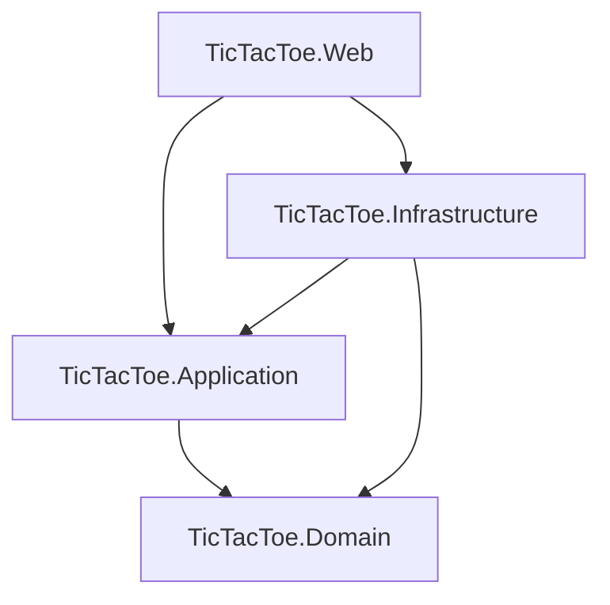
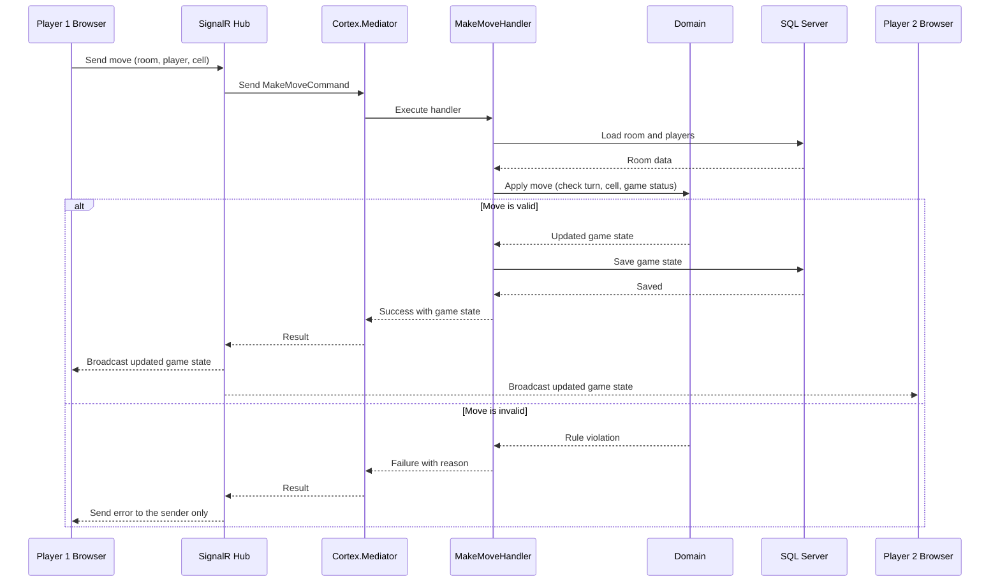

# Software Architecture Document

# TicTacToe Online

---

## 1. Document Information

| Field | Details |
|---|---|
| Project Name | TicTacToe Online |
| Project Type | Online Multiplayer Web Application |
| Document Version | 1.0 |
| Document Status | Draft |
| Date | November 4, 2026 |
| Prepared By | Senior .NET Software Architect |
| Intended Audience | Developers, project supervisors |
| Related Documents | PRD.md, TechStack.md |

---

## 2. Architecture Overview

TicTacToe Online is a single web application built with ASP.NET Core MVC. Players use their browsers to create or join a game room. During a game, SignalR delivers moves to both players in real time.

The server is the single authority for game state. The browser only displays the board and sends player actions. All rules are checked on the server before any change is saved or broadcast.

The technologies used are listed in `TechStack.md` and the product features are described in `PRD.md`. This document explains how the solution is organized and how its parts work together.

---

## 3. Architectural Style

The solution uses **Clean Architecture** with four projects. Each project has one clear job, and dependencies always point inward toward the Domain.

| Principle | Meaning in This Project |
|---|---|
| Separation of concerns | Game rules, use cases, data access, and UI live in separate projects. |
| Inward dependencies | Inner layers never know about outer layers. |
| Simplicity | No separate Web API project and no extra abstractions or design patterns. |

---

## 4. System Components

| Component | Project | Purpose |
|---|---|---|
| Domain | TicTacToe.Domain | Game entities and core game rules. |
| Application | TicTacToe.Application | Use cases (Commands, Queries, Handlers) and interfaces. |
| Infrastructure | TicTacToe.Infrastructure | Database access and persistence. |
| Web | TicTacToe.Web | Pages, controllers, SignalR Hub, and application startup. |
| Database | SQL Server | Stores rooms, players, and game state. |
| Browser client | wwwroot (HTML, CSS, JavaScript) | Shows the board and communicates with the server. |

---

## 5. Domain Layer

**Project:** TicTacToe.Domain

| Item | Description |
|---|---|
| GameRoom entity | Represents a room, its room code, its board, and its current game state. |
| GamePlayer entity | Represents a guest player in a room, including display name and symbol. |
| Enums | Game-related values such as player symbol and game status. |
| Core game rules | Turn validation, cell availability, winner detection, draw detection, and game state changes. |

**Rules**

- Must not depend on Application, Infrastructure, or Web.
- Must contain the core business rules.
- Must remain independent of external frameworks.

---

## 6. Application Layer

**Project:** TicTacToe.Application

| Item | Description |
|---|---|
| Commands | `CreateRoomCommand`, `JoinRoomCommand`, `MakeMoveCommand`, `RestartGameCommand` |
| Queries | `GetRoomQuery` |
| Handlers | One handler per Command or Query, each running one use case. |
| Interfaces | Persistence interfaces that Infrastructure implements. |
| DTOs | Simple data objects returned to the Web layer. |
| Application validation | Checks such as: room exists, room is not full, player belongs to the room. |

**Rules**

- Depends on Domain only.
- Contains the application use cases.
- Must not depend on Web or Infrastructure.
- Must not contain database implementation details.

---

## 7. Infrastructure Layer

**Project:** TicTacToe.Infrastructure

| Item | Description |
|---|---|
| ApplicationDbContext | Entry point for database operations. |
| EF Core configurations | Describe how entities are stored. |
| Migrations | Track database changes. |
| SQL Server integration | Connects the application to the database. |
| Persistence implementations | Implement the interfaces defined in Application. A repository is added only where it is truly needed. |

**Rules**

- Implements persistence interfaces defined by Application.
- Depends on Application and Domain.
- Handles database operations only.

---

## 8. Web Layer

**Project:** TicTacToe.Web

| Item | Description |
|---|---|
| MVC Controllers | Receive HTTP requests and send Commands or Queries through `IMediator`. |
| Razor Views and ViewModels | Render pages for the player. |
| SignalR Hub | Receives real-time actions and broadcasts game state. |
| Static files | CSS, JavaScript, and Bootstrap assets in `wwwroot`. |
| Startup configuration | Dependency injection setup and application startup. |

**Rules**

- Uses MVC for page rendering and HTTP requests.
- Uses Cortex.Mediator to send application requests.
- Uses SignalR Hubs for real-time communication.
- Must not contain core game business logic.

---

## 9. Project Dependency Rules

| Project | Depends On |
|---|---|
| TicTacToe.Domain | Nothing |
| TicTacToe.Application | Domain |
| TicTacToe.Infrastructure | Application, Domain |
| TicTacToe.Web | Application, Infrastructure |

**Key rules**

- Domain and Application must not depend on Web or Infrastructure.
- Infrastructure implements interfaces defined by Application.
- Web is the entry point of the application. It references Infrastructure only to register services at startup.



---

## 10. Cortex.Mediator Integration

Cortex.Mediator connects the Web layer to the Application layer. Controllers and Hubs do not call game logic directly. They send a request and receive a result.

| Concept | Role | Examples |
|---|---|---|
| Command | An operation that changes application state. | `CreateRoomCommand`, `JoinRoomCommand`, `MakeMoveCommand`, `RestartGameCommand` |
| Query | An operation that only reads data. | `GetRoomQuery` |
| Handler | Runs one use case and uses Domain rules and persistence interfaces. | `CreateRoomHandler`, `MakeMoveHandler` |

**Usage rules**

- Cortex.Mediator is used in the Application layer. MediatR is not used.
- MVC Controllers and SignalR Hubs use `IMediator` to send requests.
- Cortex.Mediator and all handlers are registered through built-in dependency injection.
- Commands, Queries, and Handlers stay small and simple.
- No pipeline behaviors are added.

---

## 11. SignalR Communication Architecture

### Role of SignalR

SignalR carries messages between the browsers and the server. It does not decide whether a move is valid. The Hub belongs to the Web project and passes every action to the Application layer.

### Process

| Step | Description |
|---|---|
| 1 | A player opens the game website. |
| 2 | The player creates a room through an MVC Controller. |
| 3 | The application generates a unique room code. |
| 4 | The second player joins using the room code. |
| 5 | Both players establish SignalR connections. |
| 6 | Both connections join the same SignalR group (one group per room). |
| 7 | A player makes a move in the browser. |
| 8 | JavaScript sends the move to the SignalR Hub. |
| 9 | The Hub sends `MakeMoveCommand` through Cortex.Mediator. |
| 10 | The Application layer validates and processes the move. |
| 11 | The updated game state is saved. |
| 12 | SignalR broadcasts the updated game state to both players. |
| 13 | Both browsers update their boards without a page refresh. |

### Security Rules

- SignalR handles communication, not business rules.
- The server is the authority for game state.
- Client-submitted board state is never trusted. The browser sends only the chosen cell.
- The server validates player identity, room membership, turn, and cell availability.
- Players are identified by a guest player ID issued by the server when they create or join a room.

### Move Flow Diagram



---

## 12. Application Request Flow

### Create Room Flow

Browser → MVC Controller → Cortex.Mediator → `CreateRoomHandler` → Domain → Infrastructure → SQL Server

The handler creates the room and its unique room code, then saves it. The controller returns the room page to the player.

### Join Room Flow

Browser → MVC Controller → Cortex.Mediator → `JoinRoomHandler` → Database → Controller → Razor View

The handler checks that the room exists and has space. If valid, the player is added and the game page is shown. If not, an error message is shown.

### Make Move Flow

JavaScript → SignalR Hub → Cortex.Mediator → `MakeMoveHandler` → Domain Validation → Infrastructure → SQL Server → SignalR Broadcast → Both Players

See the sequence diagram in Section 11.

### Restart Game Flow

JavaScript → SignalR Hub (or MVC Controller) → Cortex.Mediator → `RestartGameHandler` → Domain → Database → SignalR Broadcast

The SignalR Hub is the preferred entry point so that both players see the new game at once.

### Page Rendering Flow

Browser → MVC Controller → Cortex.Mediator Query (`GetRoomQuery`) → Application → ViewModel → Razor View → Browser

---

## 13. Proposed Project Structure

```text
TicTacToe/
│
├── src/
│   ├── TicTacToe.Domain/
│   │   ├── Entities/
│   │   └── Enums/
│   │
│   ├── TicTacToe.Application/
│   │   ├── Features/
│   │   │   ├── Rooms/
│   │   │   └── Games/
│   │   ├── Interfaces/
│   │   └── DTOs/
│   │
│   ├── TicTacToe.Infrastructure/
│   │   └── Data/
│   │
│   └── TicTacToe.Web/
│       ├── Controllers/
│       ├── Hubs/
│       ├── Models/
│       ├── Views/
│       └── wwwroot/
│
├── tests/
│   └── TicTacToe.Tests/
│
├── docs/
├── docker-compose.yml
└── README.md
```

| Folder | Contents |
|---|---|
| `Features/Rooms` | Create room, join room, and get room Commands, Queries, and Handlers. |
| `Features/Games` | Make move and restart game Commands and Handlers. |
| `Models` | ViewModels used by Razor Views. |
| `docs` | PRD.md, TechStack.md, and Architecture.md. |

---

## 14. Architectural Constraints

| Constraint | Description |
|---|---|
| MVC only | ASP.NET Core MVC only. No separate Web API project. |
| Four projects | Clean Architecture with Domain, Application, Infrastructure, and Web. |
| Mediator | Cortex.Mediator, not MediatR. |
| Real-time | SignalR for real-time communication. |
| No authentication | No login or registration. |
| No extra CQRS | No CQRS framework beyond simple Command/Query handling with Cortex.Mediator. |
| No Redis | Redis is not used. |
| No microservices | Single deployable application. |
| Minimal abstractions | No unnecessary repository abstractions. |
| Minimal packages | No unnecessary third-party libraries. |
| Database | SQL Server for persistent data. |
| Local testing | Support localhost multiplayer testing. |
| Local network | Support two computers on the same Wi-Fi network. |
