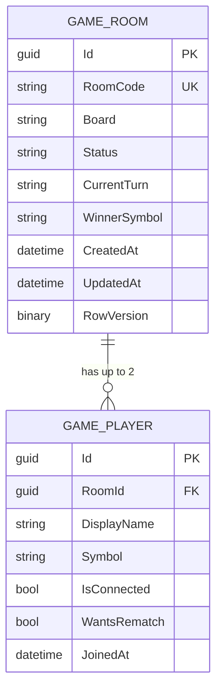

# Database Design Document

# TicTacToe Online

---

## 1. Document Information

| Field | Details |
|---|---|
| Project Name | TicTacToe Online |
| Document Version | 1.0 |
| Document Status | Draft |
| Date | November 4, 2026 |
| Database | Microsoft SQL Server |
| Access Method | Entity Framework Core (code-first with EF Core Migrations) |
| Related Documents | PRD.md, TechStack.md, Architecture.md |

---

## 2. Design Overview

The database stores only what is needed to run a game: rooms and the players inside them. It maps directly to the two Domain entities, `GameRoom` and `GamePlayer`.

| Principle | Decision |
|---|---|
| Keep it simple | Two tables. No users, accounts, chat, or history (all out of scope). |
| Server is the authority | The current board and turn are stored on the server, never taken from the browser. |
| Support reconnection | Game state is saved after every change, so a player can return to the same room. |
| Support rematch | The same room and players are reused; only the game state is reset. |

---

## 3. Entity Relationship Diagram

**Relationship:** One `GameRoom` has zero to two `GamePlayer` records. Each `GamePlayer` belongs to exactly one room.

---

## 4. Table Definitions

### 4.1 GameRooms

Stores one row per game room and its current game state.

| Column | Data Type | Null | Description |
|---|---|---|---|
| Id | uniqueidentifier | No | Primary key. |
| RoomCode | nvarchar(6) | No | Unique, short code shared between players. |
| Board | char(9) | No | Nine characters, one per cell, read left to right and top to bottom. `-` = empty, `X` or `O` = occupied. A new board is `---------`. |
| Status | nvarchar(20) | No | Current room state. See Section 5. |
| CurrentTurn | char(1) | Yes | `X` or `O`. Empty when the game is not in progress. |
| WinnerSymbol | char(1) | Yes | `X` or `O` when a player has won. Empty for a draw or unfinished game. |
| CreatedAt | datetime2 | No | When the room was created (UTC). |
| UpdatedAt | datetime2 | No | When the room was last changed (UTC). |
| RowVersion | rowversion | No | Detects conflicting updates (see Section 7). |

### 4.2 GamePlayers

Stores one row per guest player in a room.

| Column | Data Type | Null | Description |
|---|---|---|---|
| Id | uniqueidentifier | No | Primary key. Used as the guest player ID issued by the server. |
| RoomId | uniqueidentifier | No | Foreign key to `GameRooms.Id`. |
| DisplayName | nvarchar(20) | No | Guest display name entered by the player. |
| Symbol | char(1) | No | `X` or `O`, assigned by the system. |
| IsConnected | bit | No | `1` while the player has an active connection. Used to notify the opponent of interruptions. |
| WantsRematch | bit | No | `1` when the player has requested a rematch. Reset when a new game starts. |
| JoinedAt | datetime2 | No | When the player joined the room (UTC). |

---

## 5. Allowed Values

| Field | Allowed Values | Meaning |
|---|---|---|
| Status | `WaitingForPlayer` | Room created, waiting for the second player. |
| | `InProgress` | Both players present and the game is being played. |
| | `Won` | A player has won. `WinnerSymbol` is set. |
| | `Draw` | All cells are filled with no winner. |
| Symbol, CurrentTurn, WinnerSymbol | `X`, `O` | Player symbols. X always moves first. |
| Board cell | `-`, `X`, `O` | Empty, X, or O. |

---

## 6. Keys, Constraints, and Indexes

| Table | Item | Type | Purpose |
|---|---|---|---|
| GameRooms | Id | Primary key | Identifies the room. |
| GameRooms | RoomCode | Unique index | Guarantees unique room codes and gives fast lookup when joining. |
| GamePlayers | Id | Primary key | Identifies the player. |
| GamePlayers | RoomId | Foreign key, cascade delete | Links the player to a room. Deleting a room removes its players. |
| GamePlayers | (RoomId, Symbol) | Unique index | Ensures a room has at most one X and one O, which enforces the two-player limit. |
| GameRooms | Board | Check constraint | Must be exactly 9 characters, each `-`, `X`, or `O`. |
| GameRooms | Status | Check constraint | Must be one of the allowed values in Section 5. |
| GamePlayers | Symbol | Check constraint | Must be `X` or `O`. |

---

## 7. Design Decisions

| Decision | Reason |
|---|---|
| Board stored as one 9-character text value | The board is small and fixed (3x3). One column is simpler than nine columns or a separate moves table, and it is loaded and saved in a single step. |
| No Moves table | Match history is out of scope. Only the current state is needed. |
| Symbols and turn stored on the server | Supports the rule that the server validates every move and never trusts the browser. |
| `RowVersion` on GameRooms | Prevents two near-simultaneous updates from overwriting each other. The second update is rejected and the player sees the latest board. |
| `Id` used as guest player ID | There is no login, so the server-issued player ID identifies a guest and is checked against the room on every action. |
| SignalR connection ID is not stored | Connection IDs change on every reconnect. The player ID and `IsConnected` flag are enough to support reconnection. |
| Room reused for rematch | A rematch resets `Board`, `Status`, `CurrentTurn`, `WinnerSymbol`, and both `WantsRematch` flags. The room code and players stay the same. |
| UTC timestamps | Avoids time zone problems when players are in different locations. |

---

## 8. State Changes by Operation

| Operation | GameRooms | GamePlayers |
|---|---|---|
| Create room | New row. Empty board, `Status = WaitingForPlayer`, new unique `RoomCode`. | New row for the creator with symbol assigned, `IsConnected = 1`. |
| Join room | `Status` changes to `InProgress`. `CurrentTurn = X`. | New row for the second player with the remaining symbol. |
| Make move | `Board` updated. `CurrentTurn` switches, or `Status` and `WinnerSymbol` are set if the game ends. | No change. |
| Disconnect / reconnect | No change. | `IsConnected` updated. |
| Request rematch | No change. | `WantsRematch = 1` for the requesting player. |
| Start rematch (both agreed) | Board cleared, `Status = InProgress`, `CurrentTurn = X`, `WinnerSymbol` cleared. | `WantsRematch = 0` for both players. |

---

## 9. Migration and Environment Notes

| Topic | Note |
|---|---|
| Migrations | The schema is created and updated with EF Core Migrations from the Infrastructure project. |
| Local development | SQL Server runs locally or in a Docker container. |
| Docker Compose | The application and SQL Server run as separate containers. The connection string is provided through configuration. |
| Viewing data | Use SQL Server Management Studio (SSMS) to inspect tables during development. |
