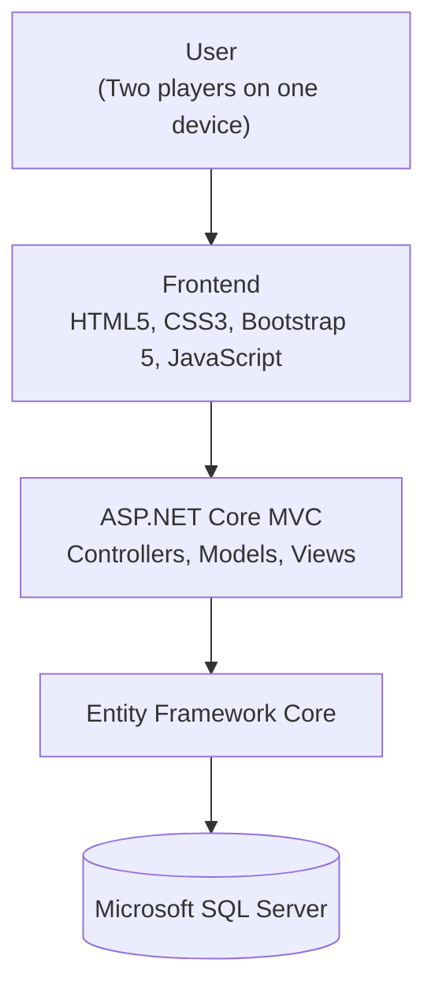
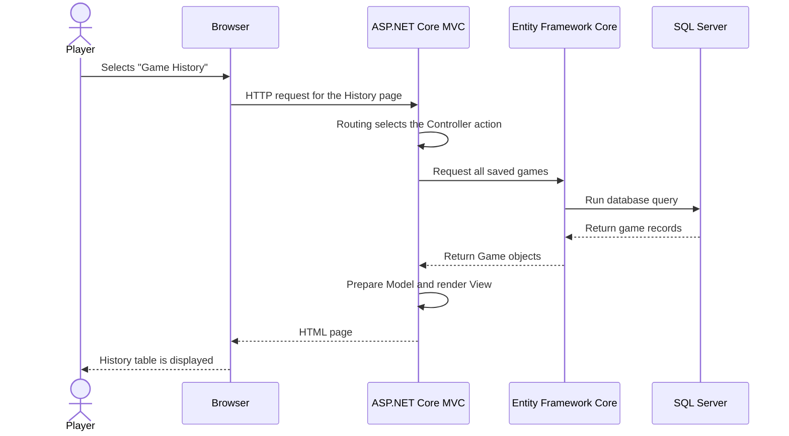
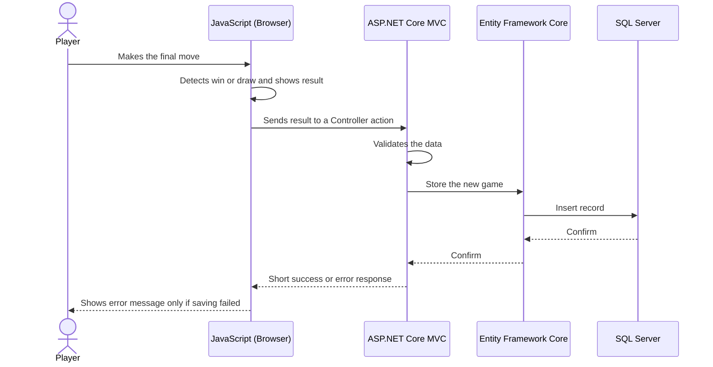

# Technology Stack Document
## Tic-Tac-Toe Web Application

---

## 1. Document Information

| Field | Details |
|---|---|
| **Document Title** | Technology Stack Document |
| **Project Name** | Tic-Tac-Toe Web Application |
| **Project Type** | Full-Stack Web Application (Course Assignment) |
| **Version** | 1.0 |
| **Date** | November 4, 2026 |
| **Document Status** | Draft – Submitted for Instructor Review |
| **File Location** | `docs/TechStack.md` |
| **Related Documents** | Product Requirements Document (PRD), Software Requirements Specification (SRS), Database Design, UI/UX Design |

---

## 2. Introduction

### 2.1 Purpose

This document describes the technologies selected to build the Tic-Tac-Toe Web Application. It explains what each technology is, why it was chosen, and how all technologies work together. It guides the design and development stages that follow.

### 2.2 Audience

| Audience | Use of This Document |
|---|---|
| Course instructor | Reviews the technical choices and their justification |
| Developer(s) | Uses the document as a reference during design and implementation |
| Future maintainers | Understands how the application is structured |

### 2.3 Scope

This document covers the technologies, tools, architecture, and integration approach. It does not contain source code, detailed database tables, or user interface designs. Those are covered in separate documents.

---

## 3. Project Overview

| Item | Description |
|---|---|
| **Project Name** | Tic-Tac-Toe Web Application |
| **Project Type** | Full-Stack Web Application |
| **Description** | A web-based Tic-Tac-Toe game where two players play against each other on the same device |
| **Main Features** | Home page, player name input, interactive 3×3 board, automatic winner and draw detection, result display, restart, scoreboard, and game history |
| **Users** | Two players sharing one device and one browser |
| **Data Stored** | Player names, game results, and date/time of completed games |

### 3.1 Technical Design Principles

| Principle | Meaning for This Project |
|---|---|
| **Simplicity** | Use the fewest technologies and layers needed to deliver the features |
| **Beginner-friendly** | Choose well-documented tools that are commonly taught in courses |
| **Single application** | Build one application that serves pages and handles data; no separate frontend project |
| **Consistency** | Keep every technology choice aligned with the project's PRD scope |
| **Maintainability** | Keep responsibilities clearly separated so each part is easy to understand and change |

---

## 4. Technology Stack Overview

### 4.1 Selected Stack Summary

| Layer | Technology | Role in the Project |
|---|---|---|
| **Frontend** | HTML5 | Page structure and content |
| | CSS3 | Custom styling and visual appearance |
| | Bootstrap 5 | Responsive layout and ready-made interface components |
| | Vanilla JavaScript | Interactive game behavior in the browser |
| **Backend** | ASP.NET Core MVC | Receives requests, applies logic, and returns pages |
| | C# | Programming language of the backend |
| **Database** | Microsoft SQL Server | Permanent storage of game records |
| **ORM** | Entity Framework Core | Connects C# code to the database |
| **Tools** | Visual Studio 2022, Visual Studio Code, SSMS, Git, GitHub | Development, database management, and version control |

### 4.2 Technologies Intentionally Not Used

| Technology / Approach | Reason Not Used |
|---|---|
| React, Angular, Vue | A separate frontend framework adds complexity that the project does not need |
| Node.js | The backend is fully built with C# and ASP.NET Core |
| Separate frontend application | The project is a single application; MVC views provide the pages |
| Microservices | A small two-player game does not need multiple services |
| Online multiplayer tools | Out of scope; both players use the same device |
| AI components | The application has no AI features; AI is used only as a development assistant |

---

## 5. Frontend Technologies

### 5.1 HTML5

| Aspect | Description |
|---|---|
| **What it is** | The standard language for structuring web page content |
| **Use in project** | Defines the Home page, player setup form, game board, scoreboard table, and history table |
| **Why selected** | It is the foundation of every web page, is supported by all browsers, and is easy to learn |

### 5.2 CSS3

| Aspect | Description |
|---|---|
| **What it is** | The standard language for styling web pages |
| **Use in project** | Styles the game board, X and O symbols, winning-cell highlight, and overall look |
| **Why selected** | It allows the interface to be clear and attractive without extra tools |

### 5.3 Bootstrap 5

| Aspect | Description |
|---|---|
| **What it is** | A popular CSS framework with a grid system and prebuilt components |
| **Use in project** | Responsive layout, navigation bar, buttons, forms, and tables |
| **Why selected** | It speeds up development, ensures a consistent look, and makes pages work on desktop, tablet, and phone |

### 5.4 Vanilla JavaScript

| Aspect | Description |
|---|---|
| **What it is** | Standard JavaScript used directly, without any framework or library |
| **Use in project** | Handles cell clicks, turn switching, winner and draw detection, result display, and restart behavior in the browser |
| **Why selected** | It is built into every browser, needs no installation, and helps beginners understand core programming concepts |

### 5.5 Frontend Responsibilities

| Responsibility | Handled By |
|---|---|
| Page structure | HTML5 |
| Visual design | CSS3 and Bootstrap 5 |
| Responsive layout | Bootstrap 5 |
| Game interaction and rules during play | Vanilla JavaScript |
| Form input fields (player names) | HTML5 with Bootstrap 5 styling |

---

## 6. Backend Technologies

### 6.1 ASP.NET Core MVC

| Aspect | Description |
|---|---|
| **What it is** | A Microsoft framework for building web applications using the Model-View-Controller pattern |
| **Use in project** | Receives browser requests, runs the application logic, reads and writes data, and returns HTML pages |
| **Why selected** | It provides a clear structure, includes built-in page rendering, and lets one project serve both pages and data handling without a separate frontend |

### 6.2 C#

| Aspect | Description |
|---|---|
| **What it is** | A modern, object-oriented programming language by Microsoft |
| **Use in project** | Used to write the Controllers, Models, and data access logic |
| **Why selected** | It is the main language of ASP.NET Core, is readable and strongly typed, and is widely taught in courses |

### 6.3 The MVC Pattern

| Component | Responsibility | Example in This Project |
|---|---|---|
| **Model** | Represents application data and its rules | A completed game (player names, result, date and time) and a scoreboard entry |
| **View** | Produces the HTML page shown to the user | Home page, game page, scoreboard page, history page |
| **Controller** | Receives a request, coordinates the work, and chooses the response | Controllers for the home page, the game, the scoreboard, and the history |

### 6.3.1 How MVC Handles Incoming HTTP Requests

1. The user opens a page or submits a form in the browser, which sends an HTTP request to the server.
2. ASP.NET Core receives the request and uses **routing** to match the web address to a specific Controller and action.
3. The selected **Controller action** runs and processes the request.
4. If data is needed, the Controller asks the data layer (Entity Framework Core) to read or write the database.
5. The Controller prepares a **Model** with the data to display.
6. The Controller passes the Model to a **View**, which creates the final HTML page.
7. The server sends the HTML (or a small data response) back to the browser.

### 6.3.2 How Controllers Process User Requests

| Step | Controller Activity |
|---|---|
| 1 | Receive the request and any submitted data (for example, player names or a game result) |
| 2 | Validate the data (for example, names must not be empty, must be different, and must be at most 20 characters) |
| 3 | Request database operations through Entity Framework Core |
| 4 | Build the Model needed by the page |
| 5 | Return a View, a redirect, or a small response to the browser |

### 6.3.3 How Models Represent Application Data

Models are C# classes that describe the information the application uses. In this project, a **Game** model describes one completed match (players, result, winner, date and time). A **Scoreboard** model describes a player's name and total wins. Models also carry validation rules, such as the required name and the maximum name length. Some Models are saved in the database; others are prepared only to be displayed.

### 6.3.4 How Views Render HTML Pages

Views are page templates that combine fixed HTML with data supplied by the Controller. For example, the History View receives a list of games and creates one table row for each game. Views use Bootstrap 5 classes for layout and styling, and a shared layout keeps the navigation bar and page frame the same on every page.

---

## 7. Database Technology

### 7.1 Microsoft SQL Server

| Aspect | Description |
|---|---|
| **What it is** | A relational database management system from Microsoft |
| **Use in project** | Permanently stores completed games so that the scoreboard and history remain available after the application is closed |
| **Why selected** | It integrates well with ASP.NET Core and Entity Framework Core, is reliable, and is commonly used in courses |

### 7.2 Data Stored

| Data Item | Purpose |
|---|---|
| Game identifier | Uniquely identifies each saved game |
| Player X name and Player O name | Shows who played |
| Result and winner name | Supports the scoreboard and history |
| Date and time played | Supports ordering of the history |

### 7.3 Database Principles

| Principle | Description |
|---|---|
| Only completed games are stored | Unfinished or restarted games are not saved |
| Scoreboard is calculated from saved games | Win totals are never edited manually |
| Minimal personal data | Only player names, results, and timestamps are kept |

Detailed table and column design is provided in the separate Database Design document.

---

## 8. ORM Technology

### 8.1 Entity Framework Core

| Aspect | Description |
|---|---|
| **What it is** | An Object-Relational Mapper (ORM) that lets C# code work with database data as objects |
| **Use in project** | Saves completed games, retrieves the history, and calculates win totals for the scoreboard |
| **Why selected** | It removes the need to write most database commands by hand, reduces errors, and supports safe data access |

### 8.2 How Entity Framework Core Communicates with SQL Server

| Step | Description |
|---|---|
| 1 | A **database context** class represents the connection to the database and the collections of stored data |
| 2 | Controllers (or a simple supporting class) ask the context to add, read, or query records using C# |
| 3 | Entity Framework Core translates these C# operations into database commands |
| 4 | SQL Server runs the commands and returns the results |
| 5 | Entity Framework Core converts the results back into C# Model objects |

### 8.3 Database Creation and Changes

The database structure is created and updated through Entity Framework Core **migrations**. A migration is a recorded set of structure changes that can be applied to the database. This keeps the database consistent with the Models and makes the setup repeatable for any developer.

---

## 9. Development Tools and Environment

| Tool | Purpose | Why Selected |
|---|---|---|
| **Visual Studio 2022** | Main environment for developing the ASP.NET Core MVC application in C# | Full support for ASP.NET Core, debugging, and Entity Framework Core |
| **Visual Studio Code** | Lightweight editor for HTML, CSS, JavaScript, and Markdown documents | Fast, free, and good for front-end files and documentation |
| **SQL Server Management Studio (SSMS)** | Viewing and checking the database and its stored data | Official tool for SQL Server; helps verify saved results |
| **Git** | Local version control | Tracks changes and allows safe experimentation |
| **GitHub** | Online repository hosting | Backup, submission, and collaboration |

### 9.1 Suggested Project Structure

| Folder | Content |
|---|---|
| `Controllers` | Controller classes |
| `Models` | Model classes and the database context |
| `Views` | Page templates and the shared layout |
| `wwwroot` | CSS and JavaScript files and other static files |
| `Migrations` | Database change history created by Entity Framework Core |
| `docs` | Project documents, including this one |

---

## 10. Application Architecture

### 10.1 Architecture Overview

The application is a single ASP.NET Core MVC application. The browser displays pages and runs the game in JavaScript. The server handles page requests, validation, and data storage. Entity Framework Core connects the application to Microsoft SQL Server.

### 10.2 Architecture Diagram

### 10.3 Layer Responsibilities

| Layer | Responsibility |
|---|---|
| **User** | Interacts with the application through a web browser |
| **Frontend** | Displays pages and runs the interactive game in the browser |
| **ASP.NET Core MVC** | Handles requests, validates data, prepares Models, and renders Views |
| **Entity Framework Core** | Translates between C# objects and database data |
| **Microsoft SQL Server** | Stores game records permanently |

### 10.4 How JavaScript Handles Interactive Game Functionality

| Function | JavaScript Behavior |
|---|---|
| Cell selection | Detects a click on a cell and places the current player's symbol if the cell is empty |
| Turn management | Starts with Player X, alternates after each valid move, and shows the current player |
| Winner detection | After each move, checks the eight possible winning lines |
| Draw detection | Declares a draw when all nine cells are filled with no winner |
| Result display | Shows the winner or draw message and highlights the winning cells |
| Board locking | Blocks further moves once the game has ended |
| Restart | Clears the board, resets the turn to Player X, and keeps the same player names |
| Saving results | When a game ends, sends the result to the server so it can be stored |

JavaScript works only inside the browser during play. The server is contacted only to open pages and to store or retrieve results.

### 10.4.1 Division of Responsibilities

| Concern | Browser (JavaScript) | Server (ASP.NET Core MVC) |
|---|---|---|
| Real-time game play | Yes | No |
| Page rendering | No | Yes |
| Server-side data validation | No | Yes |
| Database access | No | Yes |
| Scoreboard and history calculation | No | Yes |

---

## 11. Frontend and Backend Integration

The frontend and backend live in the same ASP.NET Core MVC project. There is no separate frontend application to build, host, or connect.

| Integration Point | Description |
|---|---|
| **Page delivery** | The server renders Views into HTML pages and sends them to the browser |
| **Static files** | CSS, JavaScript, and Bootstrap files are served from the project's `wwwroot` folder |
| **Form submission** | The player setup form is sent to a Controller, which validates the names and displays the game page |
| **Saving a result** | When a game ends, JavaScript sends the result to a Controller action using an asynchronous browser request, and the Controller replies with a short success or error message |
| **Scoreboard and history** | These pages are requested like any other page; the Controller loads the data and the View displays it |
| **Shared layout** | One layout provides the navigation bar and common page structure |

---

## 12. Database Integration

| Aspect | Description |
|---|---|
| **Connection** | The application connects to SQL Server using a connection string stored in the server configuration, not in browser files |
| **Database context** | A single database context class manages access to the stored games |
| **Saving** | A Controller creates a Game Model from the validated result and asks Entity Framework Core to store it |
| **History** | A Controller asks Entity Framework Core for all games, newest first, and passes them to the History View |
| **Scoreboard** | A Controller asks Entity Framework Core to count wins per player name and passes the totals to the Scoreboard View |
| **Schema changes** | Handled through Entity Framework Core migrations |
| **Verification** | The developer uses SSMS to confirm that records are stored correctly |

---

## 13. Request and Response Workflow

### 13.1 Opening a Page (for example, Game History)

### 13.2 Saving a Completed Game

### 13.3 Workflow Summary

| Step | Action | Technology |
|---|---|---|
| 1 | User opens a page or submits a form | Browser (HTML, Bootstrap) |
| 2 | Request is routed to a Controller action | ASP.NET Core MVC |
| 3 | Input is validated | C# in the Controller and Model |
| 4 | Data is read or written | Entity Framework Core |
| 5 | Commands are executed | Microsoft SQL Server |
| 6 | Data is placed in a Model | C# |
| 7 | View creates the HTML page | ASP.NET Core MVC Views |
| 8 | Page is displayed and game logic runs | Browser and JavaScript |

---

## 14. Technology Integration Workflow

This section shows how the technologies are used together in the order a user experiences them.

| Stage | User Experience | Technologies Involved |
|---|---|---|
| 1. Home | The Home page opens with links to Start Game, Scoreboard, and Game History | ASP.NET Core MVC (Controller and View), HTML5, CSS3, Bootstrap 5 |
| 2. Setup | Players enter their names; invalid names show errors | HTML5 form, Bootstrap 5, C# validation |
| 3. Play | Players take turns on the 3×3 board | HTML5, CSS3, Vanilla JavaScript |
| 4. Result | The winner or draw is shown automatically | Vanilla JavaScript |
| 5. Save | The completed game is stored | JavaScript, ASP.NET Core MVC, Entity Framework Core, SQL Server |
| 6. Scoreboard | Win totals are displayed | ASP.NET Core MVC, Entity Framework Core, SQL Server, Bootstrap 5 table |
| 7. History | Previous matches are listed, newest first | ASP.NET Core MVC, Entity Framework Core, SQL Server, Bootstrap 5 table |
| 8. Restart | The board resets; names are kept | Vanilla JavaScript |

---

## 15. Security Considerations

The application has no login and handles very little data, so security measures are kept simple and focused.

| Area | Consideration | Approach |
|---|---|---|
| **Input validation** | Player names and game results must be valid | Validate on the server in addition to the browser; reject empty, over-length, or invalid data |
| **SQL injection** | Malicious text must not alter database commands | Use Entity Framework Core, which sends data to the database safely |
| **Cross-site scripting (XSS)** | Entered names must not run as script | Rely on the automatic output encoding of MVC Views; do not insert raw user text into pages |
| **Cross-site request forgery (CSRF)** | Forms must not be submitted by other websites | Use the built-in anti-forgery protection of ASP.NET Core MVC for form submissions |
| **Connection details** | Database credentials must stay private | Store the connection string in server configuration, never in browser files or public repositories |
| **Data minimization** | Collect only what is needed | Store only player names, results, and timestamps |
| **Error handling** | Errors must not reveal internal details | Show friendly messages to users; keep technical details on the server |
| **Transport security** | Data should be protected in transit | Use HTTPS when the application is hosted |

---

## 16. Development Environment Requirements

### 16.1 Software Requirements

| Requirement | Details |
|---|---|
| Operating system | Windows 10 or 11 (recommended for Visual Studio 2022 and SSMS) |
| .NET SDK | A current supported version of the .NET SDK compatible with Visual Studio 2022 |
| IDE | Visual Studio 2022 with the **ASP.NET and web development** workload |
| Editor | Visual Studio Code |
| Database | Microsoft SQL Server (Express or Developer edition is sufficient) or SQL Server LocalDB |
| Database tool | SQL Server Management Studio (SSMS) |
| Version control | Git and a GitHub account |
| Browser | Latest version of Chrome, Edge, Firefox, or Safari |

### 16.2 Hardware Recommendations

| Component | Recommendation |
|---|---|
| Processor | Modern dual-core processor or better |
| Memory | At least 8 GB RAM |
| Storage | At least 20 GB of free disk space |

### 16.3 Setup Overview

| Step | Activity |
|---|---|
| 1 | Install Visual Studio 2022 with the web development workload |
| 2 | Install SQL Server and SSMS |
| 3 | Install Git and clone the GitHub repository |
| 4 | Configure the database connection string |
| 5 | Apply Entity Framework Core migrations to create the database |
| 6 | Run the application and test in a browser |

---

## 17. Future Technology Considerations

The following items are **not part of the current scope**. They are possible improvements for later versions and would be considered only if the project requirements change.

| ID | Consideration | Possible Benefit |
|---|---|---|
| FT-001 | Automated testing tools for C# and JavaScript | Higher confidence when making changes |
| FT-002 | Hosting on a cloud platform | Access to the application from a public web address |
| FT-003 | Logging of server errors | Easier troubleshooting |
| FT-004 | Continuous integration through GitHub | Automatic build and test on each change |
| FT-005 | Browser-side local storage for player name suggestions | Faster entry of repeated names |
| FT-006 | Light and dark display themes | Improved visual comfort |

Any change to the technology stack should be reviewed against the PRD scope to avoid adding unnecessary complexity.

---

*End of Document*
